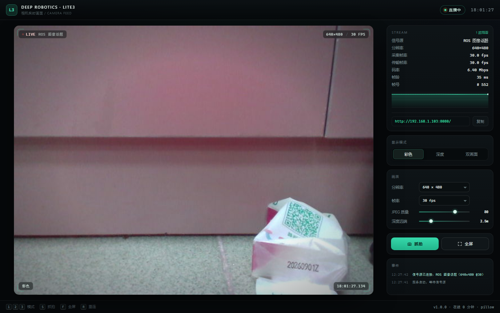
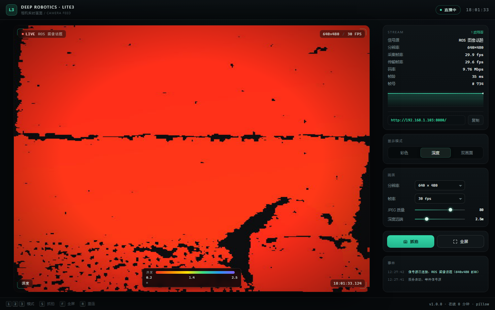
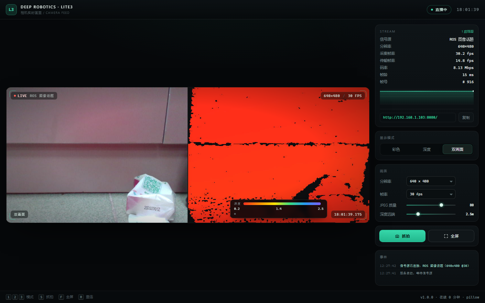

# 绝影 Lite3 · 相机网页实时画面

把机器狗（感知主机 Jetson Xavier NX）上的 RealSense D435i 画面，实时显示在**任意浏览器**里：
一台电脑打开网址就能看，不用装客户端、不用装驱动，手机也可以。



> 上图是**真机实时画面**：笔记本连上机器狗后打开 `http://192.168.1.103:8080` 截的屏。

| 彩色 | 深度 | 双画面 |
| --- | --- | --- |
|  |  |  |

---

## 1. 快速开始

```bash
python3 run.py --open        # 自动选信号源（先试 pyrealsense2 直连，不行走 ROS 话题）
```

- 没有画面就是没有画面：脚本不会给你塞假图，`/api/v1/status` 的 `last_error` 会写清原因。
- 浏览器打开 <http://127.0.0.1:8080>，右侧面板顶部会显示**可分享的访问地址**。
- 只想验证前端界面（不接相机）时，直接打开 `static/index.html` 之外的任何静态服务器也行，
  但流会一直显示"等画面"，所以推荐直接用真机跑一遍。

## 2. 在机器狗上跑

**最快：双击 `连接机器狗.bat`** —— 自动连机器狗、上传、检查依赖、启动、打开浏览器，
全程只需要你输 2~3 次密码（密码是一个英文单引号 `'`）。
网线直连时它还会提权帮你把网卡设成 `192.168.1.50`（机器狗不发 DHCP）。

> 详细的手把手步骤和排查表见 [`连接机器狗.md`](连接机器狗.md)。

在实测的 Lite3 上，脚本会自动选 **ROS 话题**（`--source ros`）：这台机器狗没装
`pyrealsense2`、也没有外网装不了，但自带 realsense-ros；脚本会顺手把 `roscore` +
`realsense2_camera` 拉起来（**不需要 sudo**），再从 `/camera/color/image_raw` 和
`/camera/aligned_depth_to_color/image_raw` 取图。实测 640×480 @ 30 fps，延迟 20~40 ms。

手动方式（脚本不听话时）：

感知主机：`ssh ysc@192.168.1.103`（密码是一个英文单引号 `'`）。

```bash
# 1) 把本目录传到机器狗（在你的电脑上执行）
scp -r 机械狗/ ysc@192.168.1.103:/home/ysc/camera_web/

# 2) 登录后启动（脚本会自己检查依赖、挑信号源、起相机节点）
ssh ysc@192.168.1.103
cd /home/ysc/camera_web
bash tools/robot_setup.sh --source auto --port 8080

# 只想单独把相机拉起来（幂等，已在跑就复用）
bash tools/robot_start_camera.sh
```

然后在本机浏览器打开 `http://192.168.1.103:8080`（PC 与机器狗接同一个局域网即可）。

### 两种取图方式

| 方式 | 命令 | 说明 |
| --- | --- | --- |
| **ROS 话题（这台狗上实测可用）** | `bash tools/robot_setup.sh --source ros` | 脚本自己起 `roscore` + `realsense2_camera`，不用密码；也可先 `sudo systemctl start realsense` 用官方服务，再 `python3 run.py --source ros` |
| 直连相机 | `python3 run.py --source realsense` | 需要 `pyrealsense2` + 先 `sudo systemctl stop realsense` 释放设备（这台狗上没装绑定、也没有外网装不了） |

> 相机节点固定用 **640×480 @ 30 fps + 深度对齐彩色**：同一台机器上，默认配置
> （1280×720 + pointcloud 滤波）会不停爆 `control_transfer returned error` /
> `Depth stream start failure`，一帧都出不来。

官方服务方式（要输一次密码）：`sudo systemctl start realsense`，跑的是
`~/lite_cog/drivers/realsense_ws/src/realsense2_camera/launch/dr_camera.launch`。
本项目 `tools/robot_start_camera.sh` 的启动参数与它等价，但以普通用户运行、不需要 root。

话题可以自己改：

```bash
python3 run.py --source ros --ros-color /camera/color/image_raw \
                          --ros-depth /camera/aligned_depth_to_color/image_raw
```

## 3. 常用参数

| 参数 | 默认 | 说明 |
| --- | --- | --- |
| `--source` | `auto` | `auto`（先 realsense 再 ros）/ `realsense` / `ros` |
| `--host` | `0.0.0.0` | 监听地址；只想本机看可改 `127.0.0.1` |
| `--port` | `8080` | 端口 |
| `--width` `--height` | `640` `480` | 分辨率，支持 640×480 / 848×480 / 960×540 / 1280×720 / 1920×1080 |
| `--fps` | `30` | 目标帧率（15 / 30 / 60） |
| `--quality` | `80` | JPEG 质量 30–95，越低越省带宽 |
| `--depth-near` `--depth-far` | `0.2` `2.5` | 深度伪彩映射范围（米） |
| `--motion-ip` | `192.168.1.120` | 运动主机 IP（发控制指令的目标） |
| `--motion-port` | `43893` | 运动主机 UDP 指令端口 |
| `--no-motion` | 关 | 关闭运动控制，只做画面监视 |
| `--api-token` | 空 | 给第三方调用的令牌；设了之后写接口必须带 `X-API-Token`（急停除外） |
| `--open` | 关 | 启动后自动打开浏览器 |

上面这些（分辨率 / 帧率 / 质量 / 深度范围）**运行中也能在网页右侧直接改**，不用重启。

## 4. 网页功能

- **三个标签页**：画面（看+调）、控制（开狗）、外加右上角的直播状态灯。
- **三种显示模式**：彩色、深度伪彩、左右双画面（深度缺失时自动禁用后两种）。
- **运动控制**（右侧「控制」标签）：启用控制 / 急停、站立坐下、回零、姿态/运动模式、6 种步态、
  9 宫格摇杆（按住才走，20Hz 持续下发）、速度滑块；键盘 `WASD`/`QE` 也能开狗。
- **实时指标**：信号源、分辨率、采集帧率、传输帧率、码率、帧龄、帧号，外加一条帧率曲线。
- **断流自愈**：连接掉了会自动重连，倒计时可见；服务端 8 秒收不到新帧会主动断开让前端重连。
- **抓拍 / 全屏**：抓拍直接下载当前模式的 JPEG 原图。
- **快捷键**：画面页 `1` `2` `3` 切模式、`S` 抓拍、`F` 全屏、`R` 重连；控制页 `空格` 急停、`Esc` 全停。
- **地址分享**：面板里的地址一键复制，手机浏览器直接打开。

## 5. 它是怎么工作的

```
RealSense D435i ──pyrealsense2──┐
 或 realsense-ros 话题 ──rospy──┴→ Hub 后台线程 → JPEG 编码（Pillow/OpenCV）
                                        │
                                       MJPEG over HTTP（multipart/x-mixed-replace）
                                        │
                              浏览器  直接解码

网页「控制」页 ──HTTP JSON──▶ /api/v1/motion/* ──UDP 43893──▶ 运动主机 192.168.1.120
```

- **为什么用 MJPEG**：浏览器原生支持，服务端只用 Python 标准库 `http.server`，
  机器狗上**不用装任何 Web 框架**；延迟低（一帧编码完立刻推走），丢包也不会花屏。
- **多客户端**：同一帧只编码一次，N 个浏览器不会把 CPU 拖垮。
- **可换传输**：想要更低带宽/更低延迟，可以后续在此基础上加 H.264/WebRTC（见第 7 节）。

目录结构：

```
run.py                    启动入口 + 命令行参数
lite3_viewer/sources.py   信号源：RealSense 直连 / ROS 图像话题
lite3_viewer/hub.py       取帧线程、帧分发、编码缓存、状态统计
lite3_viewer/encoder.py   JPEG 编码、深度伪彩、双画面拼接
lite3_viewer/motion.py    运动控制：UDP 指令帧、心跳、摇杆节流与死区
lite3_viewer/server.py    HTTP 服务：网页 + 对外开放的 /api/v1 接口
static/                   网页（HTML / CSS / JS，无任何前端依赖）
static/api-demo.html      第三方接入示例页（打开 http://IP:8080/api-demo）
docs/API.md               给别的网站/程序看的后端接口文档
tools/screenshot.py       开发用：无头浏览器截图（验证界面）
```

## 6. 给别的网站/程序用的后端接口

后端本身就是一个**普通 HTTP 服务**，任何网站、脚本、App 都能直接连：

```html
<!-- 一行放画面 -->

```

```js
// 控制
await fetch('http://192.168.1.103:8080/api/v1/motion/arm',
            { method: 'POST', headers: { 'Content-Type': 'application/json' },
              body: JSON.stringify({ on: true }) });
```

- **完整文档**：[`docs/API.md`](docs/API.md)（接口总表、每个接口的请求/响应、CORS、令牌、
  OpenAPI、跨网访问与内网穿透、运动控制安全规则、错误码、常见问题）。
- **现成示例**：浏览器打开 `http://<后端地址>/api-demo`，那个页面就是"另一个网站"，
  只用 HTTP 接口拿画面、发指令。
- **能力清单**：`GET /api/v1/info`、`GET /api/v1/commands`、`GET /api/v1/openapi.json`
  （可导入 Postman / Apifox 自动生成客户端）。
- 已开启 CORS（`Access-Control-Allow-Origin: *`），任意域名网页可直接调用；
  公网暴露前记得加 `--api-token`。

| 方法 | 路径 | 说明 |
| --- | --- | --- |
| GET | `/api/v1/info` | 能力清单（信号源、模式、分辨率、能否控制） |
| GET | `/api/v1/status` | 综合状态（帧率、帧龄、配置、运动状态、观看数） |
| GET | `/api/v1/snapshot.jpg?mode=color` | 单帧 JPEG |
| GET | `/api/v1/stream?mode=color` | MJPEG 实时流 |
| POST | `/api/v1/config` | 热改分辨率/帧率/画质/深度范围 |
| POST | `/api/v1/motion/arm` | 启用 / 解除控制（自动 2Hz 心跳） |
| POST | `/api/v1/motion/command` | 动作指令（站立/坐下/步态/模式…） |
| POST | `/api/v1/motion/axes` | 摇杆量（≥20Hz，400ms 不刷新自动归零） |
| POST | `/api/v1/motion/stop` | 急停（永远免令牌） |

## 7. 排查

| 现象 | 原因与处理 |
| --- | --- |
| 网页一直“等待画面” | 服务端没起来，或端口被占：看启动时的报错；确认 `http://IP:端口/api/health` 能返回 |
| 事件里报 “设备忙 / 拒绝访问” | `sudo systemctl stop realsense` 释放相机，或改用 `--source ros` |
| 报 `No module named 'pyrealsense2'` | 感知主机没装绑定；走 `--source ros`（这台狗默认就是它） |
| 事件里报 “相机没出画面” | 服务在跑但相机没数据：`bash tools/robot_start_camera.sh --restart`，或 `rs-enumerate-devices` 看相机是否枚举到 |
| 帧率不到设定值 | 降低分辨率/质量；USB 线要插 USB3.0 口；Jetson 上别同时开 realsense-viewer |
| 深度是纯色 | 深度流没拿到：确认跑的是 `--source realsense` 或 ROS 里订阅了对齐深度话题 |
| 手机打不开 | 手机与机器狗不在同一网段；检查防火墙 `sudo ufw status` |

## 8. 后续可以加

- 状态回读（电量 / 姿态角 / 步态）：运动主机的 `0x0901` 只上报给感知主机的 43897，
  被机器狗自带的 `lite3_transfer` 占着；需要从它的 ROS2 话题（`/imu/data`、`/joint_states`、
  `/us_publisher/ultrasound_distance`）取，得加一个 rclpy 旁路进程。
- H.264 / WebRTC 传输：带宽再降一个量级，适合 4G 远程。
- 录像与回放、时间轴。
- 在服务端加目标检测/测距，把结果画在画面上再推流。
